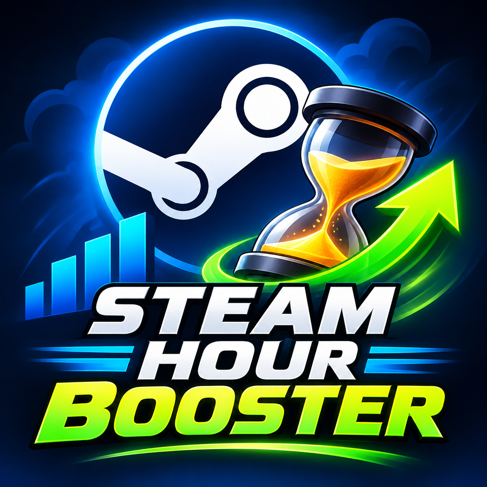

<div align="center">

<!-- Animated Header Banner -->


<!-- Badges Row -->
<p>
  
  
  
  
  
  
</p>

<!-- Steam Badge -->
<p>
  
  
  
  
</p>

<br/>

> **SteamPulse** is a lightweight, open-source Windows desktop application that boosts Steam playtime hours for your games — without downloading or running them. It uses native Steamworks API calls via P/Invoke in isolated background worker processes.

<br/>

<!-- Typing animation effect text -->
<a href="https://github.com/YIGeenula/Steam-Hour-Booster/releases/latest">
  
</a>
&nbsp;
<a href="https://github.com/YIGeenula/Steam-Hour-Booster/releases">
  
</a>
&nbsp;
<a href="https://github.com/YIGeenula/Steam-Hour-Booster/stargazers">
  
</a>

</div>

---

## 📸 Preview

<div align="center">



</div>

---

## ✨ Features

<table>
<tr>
<td width="50%">

### 🎮 Core Boosting
- **Background Worker Processes** — Each game runs in a separate hidden process with near **0% CPU & RAM** usage
- **Steamworks Native API** — Uses the official `steam_api64.dll` via P/Invoke with dynamic symbol resolution
- **Multi-game simultaneous boosting** — Boost all your games at once with **Start All**
- **Session & Lifetime timers** — Live `HH:MM:SS` session counter + persistent total boosted time
- **Clean shutdown** — `SteamAPI_Shutdown()` called correctly on every exit

</td>
<td width="50%">

### 🔍 Steam Integration
- **Auto Steam Library Detection** — Scans your locally installed games from all Steam library folders on launch
- **Active Account Detection** — Reads registry to detect logged-in Steam user
- **Steam Store Game Names** — Resolves game names from local `appinfo.vdf` cache & Steam Web API
- **Cover Art Auto-Fetch** — Loads `header.jpg` from Steam CDN for every game card automatically
- **Login Status Check** — Shows clear warning if Steam is not logged in

</td>
</tr>
<tr>
<td width="50%">

### 🖥️ Modern UI
- **Borderless Dark Window** — Rounded corners, custom title bar, drag-to-move
- **Deep Slate Theme** — `#0B0F17` background with solid `SolidColorBrush` palette (no gradients)
- **Custom App Icon** — Embedded `.ico` shown in taskbar, Alt+Tab, and Explorer
- **Tabular mono fonts** — Cascadia Mono / Consolas for timers with `Typography.NumeralAlignment=Tabular`
- **Search & Filter** — Real-time search bar + sidebar filters (All / Boosting / Idle)

</td>
<td width="50%">

### 🔄 Quality of Life
- **GitHub Auto-Update Check** — Checks `api.github.com` on launch and shows an update banner if a new version exists
- **Sync Steam button** — One-click import of all your Steam library games
- **Persistent JSON config** — Game list and lifetime boosted seconds saved to `games_config.json`
- **Manual Add** — Add any game by name + App ID even if it's not installed locally
- **Delete games** — Remove individual games from the boost list instantly

</td>
</tr>
</table>

---

## 🛠️ How It Works

```
┌──────────────────────────────────────────────────────────────┐
│                    SteamPulse.exe  (Main UI)                 │
│  WPF Window · Game Library · Filters · Steam Status Check    │
└──────────────────┬───────────────────────────────────────────┘
                   │  Process.Start("SteamPulse.exe --worker <AppID>")
                   │  (one hidden process per game)
         ┌─────────▼──────────┐
         │  Worker Process 1  │
         │  AppID: 292030     │  ◄── SteamAPI_Init()
         │  SteamAPI_RunCallbacks() every 1s │
         │  ~0% CPU / ~8 MB RAM              │
         └────────────────────┘
         ┌────────────────────┐
         │  Worker Process 2  │
         │  AppID: 238090     │  ◄── SteamAPI_Init()
         │  SteamAPI_RunCallbacks() every 1s │
         └────────────────────┘
                   ▲
                   │  Stdout/Stderr captured, exit code monitored
         ┌─────────┴──────────┐
         │   Steam Client     │  ← Must be running & logged in
         │   steam.exe        │
         └────────────────────┘
```

> **Why separate processes?** The Steamworks SDK only allows **one** `SteamAPI_Init()` call per process. By spawning one hidden child process per game, SteamPulse can boost multiple games simultaneously without restrictions.

---

## 🔧 Architecture & File Structure

```
Steam Hour Booster/
│
├── 📄 SteamPulse.csproj          — Project config (net10.0-windows, x64, WPF)
├── 🎨 App.xaml / App.xaml.cs     — Application entry point, routes --worker args
├── 🎨 MainWindow.xaml             — Full WPF layout (sidebar, game cards, status bar)
├── ⚙️  MainWindow.xaml.cs         — Code-behind (workers, filters, sync, update check)
├── 🎨 Theme.xaml                  — All SolidColorBrush resources & control styles
├── 🔑 softwareIcon.ico            — Application icon (embedded)
├── 📦 steam_api64.dll             — Valve Steamworks SDK (x64, v08.63.11.84)
│
├── 📂 Native/
│   └── SteamNative.cs            — P/Invoke layer: LoadLibrary + dynamic binding
│                                    (SteamAPI_InitSafe → SteamAPI_InitFlat fallback)
│
├── 📂 Models/
│   └── GameEntry.cs              — INotifyPropertyChanged model (Name, AppId,
│                                    IsBoosting, SessionTime, TotalBoosted, ...)
│
├── 📂 Worker/
│   └── WorkerProgram.cs          — CLI worker: sets env vars, calls SteamAPI_Init,
│                                    loops RunCallbacks every 1s, shuts down cleanly
│
├── 📂 Services/
│   ├── SteamLibraryDetector.cs   — Reads registry + localconfig.vdf + appmanifest.acf
│   │                                to detect all owned/installed Steam games
│   ├── UpdateChecker.cs          — GitHub Releases API integration (YIGeenula/Steam-Hour-Booster)
│   └── ThemeManager.cs           — Theme switching utilities (reserved)
│
├── 📂 Converters/
│   └── Converters.cs             — BoolToColorConverter, BoolToVisibilityConverter,
│                                    BoolToActionBrushConverter (all solid brushes)
│
└── 📄 games_config.json          — Runtime: saved game list + TotalBoostedSeconds
```

---

## 🚀 Getting Started

### Prerequisites

| Requirement | Details |
|------------|---------|
| **OS** | Windows 10 / 11 (64-bit) |
| **.NET Runtime** | [.NET 8+](https://dotnet.microsoft.com/download/dotnet/8.0) or [.NET 10+](https://dotnet.microsoft.com/download) (auto-detected) |
| **Steam** | Steam client installed & **logged in** to your account |
| **Games** | The games must be **owned by your Steam account** |

### Option A — Download Release (Recommended)

1. Go to [**Releases**](https://github.com/YIGeenula/Steam-Hour-Booster/releases/latest)
2. Download `SteamPulse-v1.x.x.zip`
3. Extract to any folder
4. Run `SteamPulse.exe`

> ⚠️ **Important:** Make sure Steam is running and you're logged in before launching SteamPulse.

### Option B — Build from Source

```powershell
# Clone the repository
git clone https://github.com/YIGeenula/Steam-Hour-Booster.git
cd SteamPulse

# Place steam_api64.dll in the project root
# (Download from your Steam installation: C:\Program Files (x86)\Steam\steamapps\...)

# Build Release (x64)
dotnet build -c Release

# Run
.\bin\Release\net10.0-windows\SteamPulse.exe
```

> **Note:** `steam_api64.dll` is NOT included in this repository due to Valve's distribution terms. You must source it yourself from your local Steam installation or the [Steamworks SDK](https://partner.steamgames.com/doc/sdk).

---

## 📖 Usage Guide

### 1. Auto-Detect Your Steam Library

When SteamPulse opens, it **automatically scans** your Steam account and imports all your games. You can also click **"Sync Steam"** at any time to refresh.

```
✅ Steam Connected (User: 1422716077)
🔄 Syncing...
🎉 Successfully imported 11 games from your Steam account!
```

### 2. Manually Add a Game

Use the sidebar **"ADD TO BOOST LIST"** panel:
- Enter the **Game Title** (any name you prefer)
- Enter the **Steam App ID** (find it at `store.steampowered.com/app/<AppID>`)
- Click **Add Game**

### 3. Start Boosting

- Click **BOOST** on any individual game card, or
- Click **▶ Start All** to begin boosting every game in your list

The session timer ticks live while boosting is active.

### 4. Stop Boosting

- Click **STOP** on a specific card, or
- Click **■ Stop All** to terminate all workers at once

All processes are killed cleanly with `SteamAPI_Shutdown()` called.

### 5. Filters

Use the sidebar filters to view:
| Filter | Description |
|--------|-------------|
| **All Games** | Your complete boost library |
| **Currently Boosting** | Only games actively running |
| **Idle Games** | Games not currently boosting |

---

## ⚙️ Technical Details

### Native P/Invoke — `steam_api64.dll`

SteamPulse uses **dynamic symbol resolution** instead of static DllImport to handle differences across Steam SDK versions:

```csharp
// Priority chain: SteamAPI_InitSafe → SteamAPI_InitFlat
_initSafeFn  = GetProc<SteamAPI_InitSafe_t>("SteamAPI_InitSafe");   // ← primary
_initFlatFn  = GetProc<SteamAPI_InitFlat_t>("SteamAPI_InitFlat");   // ← fallback
_shutdownFn  = GetProc<SteamAPI_Shutdown_t>("SteamAPI_Shutdown");
_callbacksFn = GetProc<SteamAPI_RunCallbacks_t>("SteamAPI_RunCallbacks");
```

The Steam install directory is auto-detected from registry and prepended to PATH before loading, ensuring `steamclient64.dll` dependencies resolve correctly.

### Worker Process Architecture

```csharp
// Main UI spawns per-game workers:
var proc = new Process {
    StartInfo = {
        FileName  = "SteamPulse.exe",
        Arguments = $"--worker {AppId}",
        CreateNoWindow   = true,
        UseShellExecute  = false,
        RedirectStandardError = true
    }
};

// Worker sets mandatory Steam env vars:
Environment.SetEnvironmentVariable("SteamAppId",  appId.ToString());
Environment.SetEnvironmentVariable("SteamGameId", appId.ToString());
File.WriteAllText("steam_appid.txt", appId.ToString());

// Low-overhead loop (~0% CPU):
while (!shutdownRequested) {
    SteamAPI_RunCallbacks();
    Thread.Sleep(1000);
}
SteamAPI_Shutdown();
```

### Steam Library Detection Strategy

```
1. Registry  →  HKCU\Software\Valve\Steam\ActiveProcess  (ActiveUser ID)
2. VDF parse →  steamapps/libraryfolders.vdf              (all library paths)
3. ACF scan  →  appmanifest_*.acf                         (installed games + names)
4. VDF parse →  userdata/{id}/config/localconfig.vdf      (played/owned games)
5. Binary    →  appcache/appinfo.vdf                      (local game name cache)
6. HTTP      →  store.steampowered.com/api/appdetails     (online fallback)
```

### Color Palette

| Token | Hex | Use |
|-------|-----|-----|
| `BrushWindowBg` | `#0B0F17` | Window background |
| `BrushPanelBg` | `#131924` | Card/panel surface |
| `BrushElevated` | `#1A2232` | Input fields, badges |
| `BrushTextPrimary` | `#F1F5F9` | Main text |
| `BrushTextSecondary` | `#94A3B8` | Muted labels |
| `BrushPrimary` | `#2563EB` | Primary action buttons |
| `BrushSuccess` | `#10B981` | Active/boosting indicator |
| `BrushDangerSurface` | `#2A161A` | Stop/danger background |
| `BrushDangerForeground` | `#F87171` | Danger text/icons |

---

## ❓ FAQ

<details>
<summary><b>🔴 "SteamAPI_Init failed: Steam is not running or this account does not own the game"</b></summary>

This means one of:
1. **Steam is not running** — Launch Steam first
2. **Not logged in** — Log into your Steam account
3. **Game not owned** — Your account doesn't own this App ID; you can only boost games you own
4. **Family sharing** — Shared library games may not be boostable

</details>

<details>
<summary><b>🟡 "Steam running (Not Logged In)" in the status bar</b></summary>

Steam is open but no user session is active. This can happen if:
- Steam is in offline mode without a cached user
- You recently switched accounts and Steam hasn't fully loaded the new session

**Fix:** Log in to your account in Steam normally, wait for the library to load, then try again.

</details>

<details>
<summary><b>🔵 Can I boost games I don't own?</b></summary>

**No.** The Steamworks API validates game ownership against your Steam account server-side. `SteamAPI_Init()` will fail (exit code 1) for any game your account does not own.

</details>

<details>
<summary><b>🔵 Will this get me VAC banned?</b></summary>

SteamPulse only calls `SteamAPI_RunCallbacks()` — it does not inject into any game process, modify game files, or interact with any game's anti-cheat system. However, **use at your own risk**. No tool that interacts with Steam can offer a 100% guarantee.

</details>

<details>
<summary><b>🔵 Where is my game list saved?</b></summary>

Your game list is saved to `games_config.json` in the same folder as `SteamPulse.exe`. You can back it up or share it across devices.

</details>

<details>
<summary><b>🔵 How much RAM/CPU does it use?</b></summary>

The main UI uses ~20–30 MB RAM. Each worker process uses ~8–12 MB RAM and **~0% CPU** (it sleeps for 1 second between each `SteamAPI_RunCallbacks()` call). You can boost many games simultaneously with minimal system impact.

</details>

---

## 🤝 Contributing

Contributions are welcome! This is a fully open-source project.

```bash
# Fork the repo, then:
git checkout -b feature/your-feature-name
# ... make your changes ...
git commit -m "feat: add your feature"
git push origin feature/your-feature-name
# Open a Pull Request on GitHub
```

**Areas that need help:**
- 🌐 Localization / multi-language support
- 🎨 Additional UI themes
- 📊 Steam playtime statistics dashboard
- 🔔 System tray / minimize-to-tray
- 🧪 Unit tests for `SteamLibraryDetector`

---

## 📋 Changelog

### v1.0.0 — Initial Release
- ✅ Background worker process architecture (one process per game)
- ✅ Dynamic P/Invoke with `SteamAPI_InitSafe` → `SteamAPI_InitFlat` fallback chain
- ✅ Auto Steam library detection from registry + VDF + ACF files
- ✅ Steam account login status detection & warning banners
- ✅ Live session timers + persistent lifetime boosted time
- ✅ GitHub Releases auto-update checker
- ✅ Steam CDN cover art auto-fetch
- ✅ Game list saved to `games_config.json`
- ✅ Borderless WPF window with custom title bar
- ✅ Dark mode slate palette (all `SolidColorBrush`, no gradients)
- ✅ Sidebar filters: All / Boosting / Idle
- ✅ Real-time search
- ✅ Start All / Stop All bulk controls
- ✅ Custom app icon (embedded `.ico`)

---

## ⚖️ Legal & Disclaimer

> **SteamPulse is an independent open-source project. It is NOT affiliated with, endorsed by, or connected to Valve Corporation or Steam in any way.**

- The `steam_api64.dll` file is property of **Valve Corporation** and is distributed separately under the [Steamworks SDK](https://partner.steamgames.com/doc/sdk) terms.
- This software is provided "as is" without warranty of any kind.
- Using playtime boosters may violate Steam's Terms of Service. **Use at your own risk.**
- The authors of SteamPulse are not responsible for any account actions taken by Valve.

---

## 📄 License

```
MIT License

Copyright (c) 2026 GeeNuuSs

Permission is hereby granted, free of charge, to any person obtaining a copy
of this software and associated documentation files (the "Software"), to deal
in the Software without restriction, including without limitation the rights
to use, copy, modify, merge, publish, distribute, sublicense, and/or sell
copies of the Software, and to permit persons to whom the Software is
furnished to do so, subject to the following conditions:

The above copyright notice and this permission notice shall be included in all
copies or substantial portions of the Software.

THE SOFTWARE IS PROVIDED "AS IS", WITHOUT WARRANTY OF ANY KIND, EXPRESS OR
IMPLIED, INCLUDING BUT NOT LIMITED TO THE WARRANTIES OF MERCHANTABILITY,
FITNESS FOR A PARTICULAR PURPOSE AND NONINFRINGEMENT.
```

---

<div align="center">


**Made with ❤️ by [GeeNuuSs](https://github.com/GeeNuuSs)**

<p>
  <a href="https://github.com/YIGeenula/Steam-Hour-Booster/releases/latest">
    
  </a>
  &nbsp;
  <a href="https://github.com/YIGeenula/Steam-Hour-Booster/issues">
    
  </a>
  &nbsp;
  <a href="https://github.com/YIGeenula/Steam-Hour-Booster/discussions">
    
  </a>
</p>

<sub>If SteamPulse helped you, consider giving it a ⭐ on GitHub!</sub>

</div>
